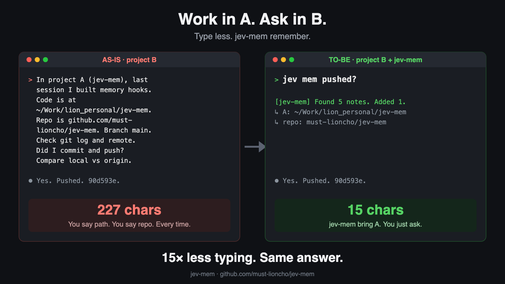
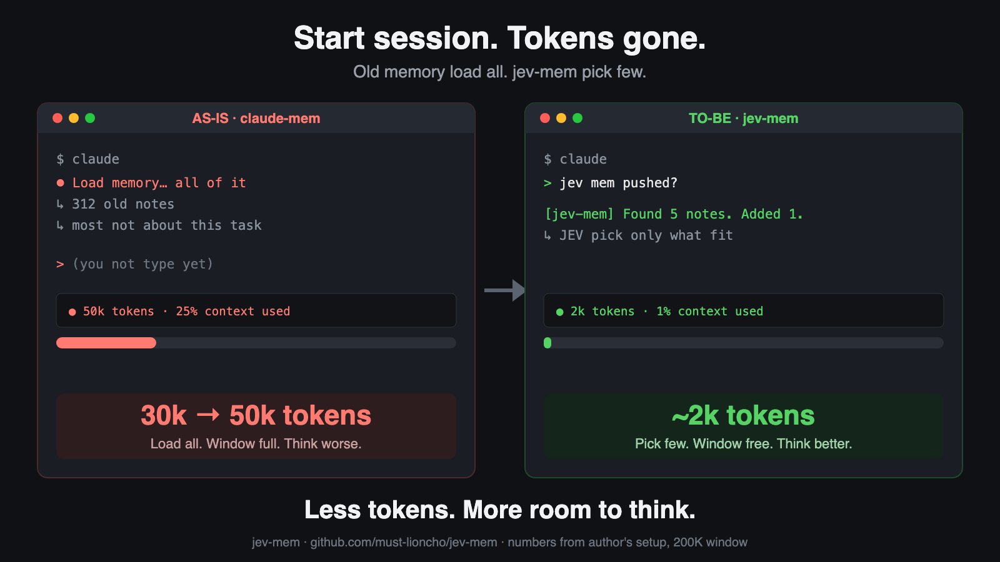
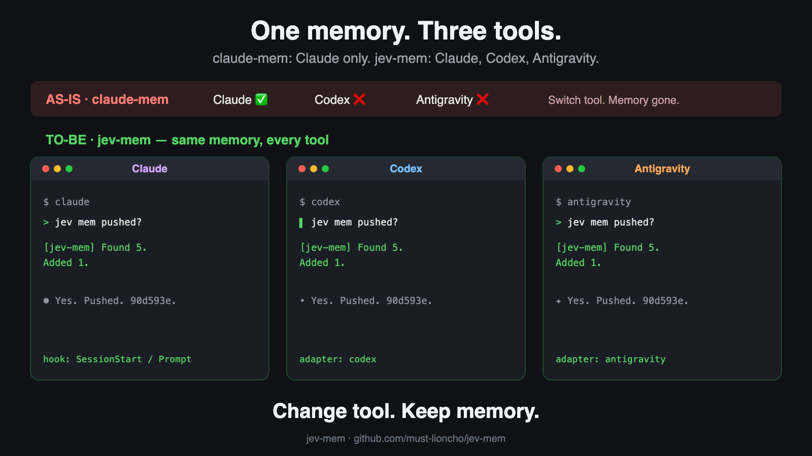

# jev-mem

[한국어 안내](README.kr.md)







## Why this exists

Agents redo work that was already done. The fix is to bring back the earlier session's
notes, but bringing them back is where the cost hides:

- **Too many tokens.** In the author's setup, claude-mem loaded about 30K tokens of past
  context every time a session opened.
- **Context window gone before you start.** On a 200K-context model that is 15-30% of the
  window used before the first prompt. A 1M window softens this, but the same load repeats
  in every session.
- **Fast but not accurate.** claude-mem finds records without AI (vector match only). That
  is fast, but it cannot tell a related record from one that shares a few words, so most
  of those tokens go to records the task does not need. This was the biggest problem.
- **Settings are not enough.** claude-mem can lower the limits, but a fixed number cannot
  decide which record matters for this prompt.

jev-mem keeps the fast search as a first pass and lets JEV, an AI judge, decide which record
is actually relevant. One good record goes in; when none fit, nothing goes in. It works the
same way in Claude Code, Codex, and Antigravity.

Inject only the [claude-mem](https://github.com/thedotmack/claude-mem) records that
[JEV](https://docs.typesafe.ai) judges relevant to the prompt you just typed.

claude-mem's built-in prompt-time injection (`CLAUDE_MEM_SEMANTIC_INJECT`) adds the top
vector matches every time, with no relevance floor. A prompt that starts new work still gets
five records that only share a few words with it. This plugin keeps claude-mem's vector
search as the first pass and adds JEV as the judge:

1. On `UserPromptSubmit`, ask the local claude-mem worker for the top 5 vector matches.
2. Send the prompt and the 5 records to JEV in one request: one yes/no question per record.
3. Inject the record with the highest yes-probability, only if it reaches the threshold.
   If no record reaches it, inject nothing.

Measured on one machine (2026-10-18, claude-mem 14.0.1): about 0.5 s per prompt.

| Prompt | claude-mem built-in | jev-mem |
| --- | --- | --- |
| Asks about an earlier claude-mem settings change | 5 records | 1 record (JEV 0.85) |
| Starts an unrelated blog post | 5 unrelated records | nothing (max JEV 0.05) |
| Asks to translate a screenshot | 5 unrelated records | nothing (max JEV 0.28) |

Three prompts are an example, not a benchmark. JEV judges relevance, not truth: an
outdated record on the right topic can still be selected.

## Measuring AI-era work

AI-era work has two metrics:

1. **Lead time**: the time from signal to production.
2. **Human intervention**: how many prompts a person actually typed to get there.

jev-mem already reads every session to choose memory records, so it is also the right place to collect these statistics.

`jev-mem human-count` counts the prompts a person typed in every session related to a topic. It covers Claude, Codex and Antigravity.

- Coverage: it includes prompts queued while a turn was still running.
- Exclusions: it ignores hook text, system reminders and tool results.
- Relevance: a keyword filter picks candidate sessions. JEV then decides, session by session, whether each one belongs to the topic.
- Privacy: prompt text is not printed unless you pass `--show`.

```sh
jev-mem human-count --topic "<project>" --since 2026-10-18T00:00:00+05:30 \
  --keywords "<alias>,<alias>" --json --out human-interventions.json
```

Run it on demand, for example from a dashboard's refresh button. Do not run it on a timer.

Lead-time measurement is not built yet.

## Runtimes

Not only Claude. The same core runs behind a small adapter per runtime, so you keep using
the CLI you already use and the hook runs on its own.

| Runtime | Hook file | Hook event | Command |
| --- | --- | --- | --- |
| Claude Code (and GLM via `glm-claude`) | `~/.claude/settings.json` | `UserPromptSubmit` | `node <repo>/scripts/hook.mjs --runtime claude` |
| Codex CLI | `~/.codex/hooks.json` | `UserPromptSubmit` | `node <repo>/scripts/hook.mjs --runtime codex` |
| Antigravity CLI (`agy`) | `~/.gemini/config/hooks.json` | `PreInvocation` | `node <repo>/scripts/hook.mjs --runtime agy` |

Each turn shows one line, for example
`[jev-mem] Found 5 notes. Added the best 1 (#374, 81% match) (0.6s).`
With jev-router it appears right after the `[Jev] routed ...` line.

## Requirements

- Claude Code, Codex CLI, or Antigravity CLI
- claude-mem installed with its worker running (the memory store)
- Node.js 20.12+
- A JEV key from [TypeSafe](https://docs.typesafe.ai)

## Install

### With jev-router (recommended order)

Install and set up [jev-router](https://github.com/must-lioncho/jev-router-effort) first,
then this plugin. jev-router writes the key this plugin reuses (`~/.jev-router.env`).

Why the order does not cost routing tokens: jev-router is a proxy. Claude Code runs every
`UserPromptSubmit` hook before the request leaves, so the proxy always routes after this
plugin has run. Hook output arrives inside `<system-reminder>` blocks, and jev-router strips
those blocks before asking JEV for a model. The injected record therefore does not enlarge
or change the routing decision. It only reaches the model that answers.

### Steps

```bash
# 1. Hook (one adapter per runtime; Claude today, Codex and Gemini next)
#    Add to ~/.claude/settings.json under hooks.UserPromptSubmit, after jev-router:
#    node /path/to/jev-mem/scripts/hook.mjs --runtime claude
#    Claude-only alternative: claude plugin marketplace add must-lioncho/jev-mem && claude plugin install jev-mem@jev-mem

# 2. JEV key (skip if jev-router is already set up)
echo "JEV_API_KEY=..." > ~/.jev-router.env

# 3. Turn off claude-mem's own injection so records are not added twice
git clone https://github.com/must-lioncho/jev-mem && cd jev-mem
node bin/jev-mem.mjs setup            # shows the change
node bin/jev-mem.mjs setup --apply    # writes it, keeps a backup and your other keys

# 4. Check
node bin/jev-mem.mjs doctor
```

`setup --apply` sets `CLAUDE_MEM_SEMANTIC_INJECT=false`,
`CLAUDE_MEM_CONTEXT_OBSERVATIONS=0` and `CLAUDE_MEM_CONTEXT_SESSION_COUNT=0` in
`~/.claude-mem/settings.json`. claude-mem keeps recording; only its automatic injection
stops. Start a new session afterwards.

## Settings

`~/.jev-mem/settings.json` (all optional):

```json
{
  "mode": "top1",
  "candidates": 5,
  "maxInject": 5,
  "minProbability": 0.7,
  "format": "narrative",
  "scope": "project"
}
```

| Key | Default | Meaning |
| --- | --- | --- |
| `mode` | `top1` | `top1` injects the single best record. `all` injects every record that passes, up to `maxInject`. |
| `candidates` | `5` | Vector matches JEV judges (1–20). |
| `maxInject` | `5` | Cap for `mode: all`. |
| `minProbability` | `0.7` | JEV yes-probability a record needs. Raise it to inject less. |
| `format` | `narrative` | `narrative`: record text. `index`: one line with the id. |
| `scope` | `project` | `project`: this repository first, all projects if it has none. `all`: every project. |
| `timeoutMs` | `6000` | Total budget. On timeout nothing is injected. |
| `enabled` | `true` | Turn the hook off without uninstalling. |
| `logPrompt` | `false` | Store prompt text in the decision log (off: length and hash only). |

Environment overrides: `JEV_MEM_MODE`, `JEV_MEM_MIN_PROBABILITY`,
`JEV_MEM_CANDIDATES`, `JEV_MEM_MAX_INJECT`, `JEV_MEM_FORMAT`,
`JEV_MEM_SCOPE`, `JEV_MEM_TIMEOUT_MS`, `JEV_MEM_ENABLED`.

## Tuning

```bash
node bin/jev-mem.mjs try "the prompt you want to test"
```

prints every candidate with its vector rank and JEV probability, and the exact text that
would be injected. Each real prompt is logged to `~/.jev-mem/decisions.jsonl` with
candidate ids, probabilities, what was injected and the latency, so the threshold can be set
from evidence.

## Failure behavior

Every failure injects nothing and never blocks the prompt: missing JEV key, worker down,
JEV error, timeout, prompt shorter than 20 characters.

## Data sent

To JEV (`api.typesafe.ai`): the prompt (first 2,000 characters) and, per candidate, its
title, subtitle, a 700-character summary and date. Nothing else from the session. To the
claude-mem worker (localhost only): the prompt as a search query.

## License and names

MIT. This plugin contains no claude-mem code; it calls the claude-mem worker's local HTTP
API. claude-mem is Apache-2.0, © Alex Newman. This project is not affiliated with or endorsed
by Anthropic, the claude-mem project, or TypeSafe. "Claude" is a trademark of Anthropic.
The names are used only to say what this plugin works with. See [NOTICE](NOTICE).
